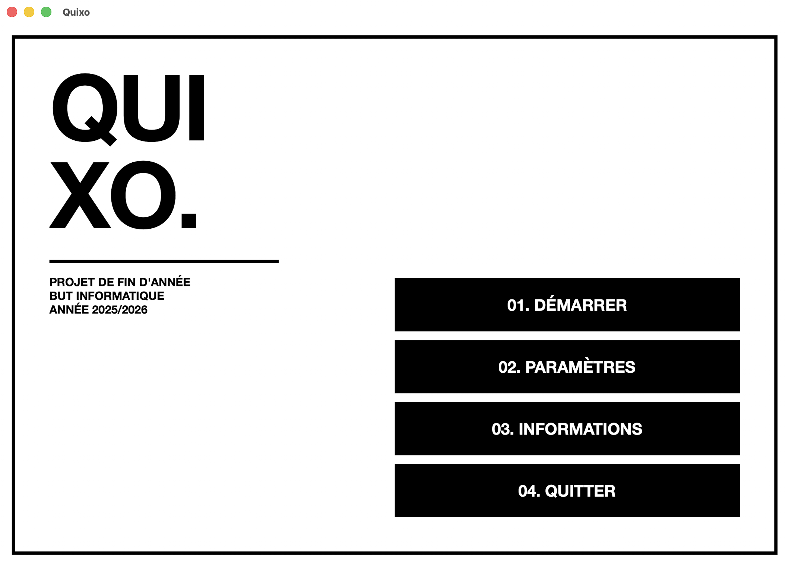
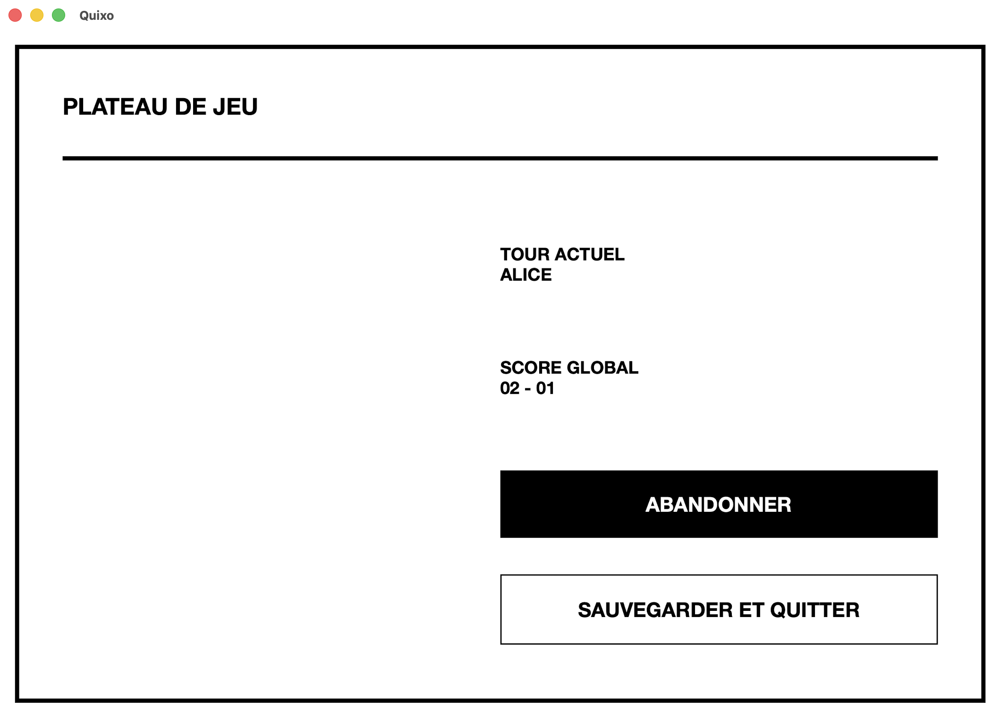
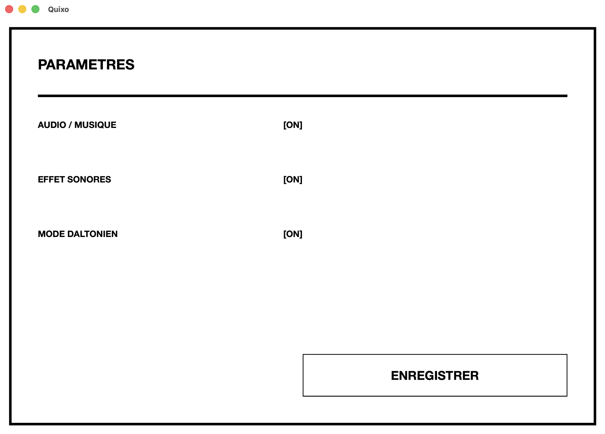
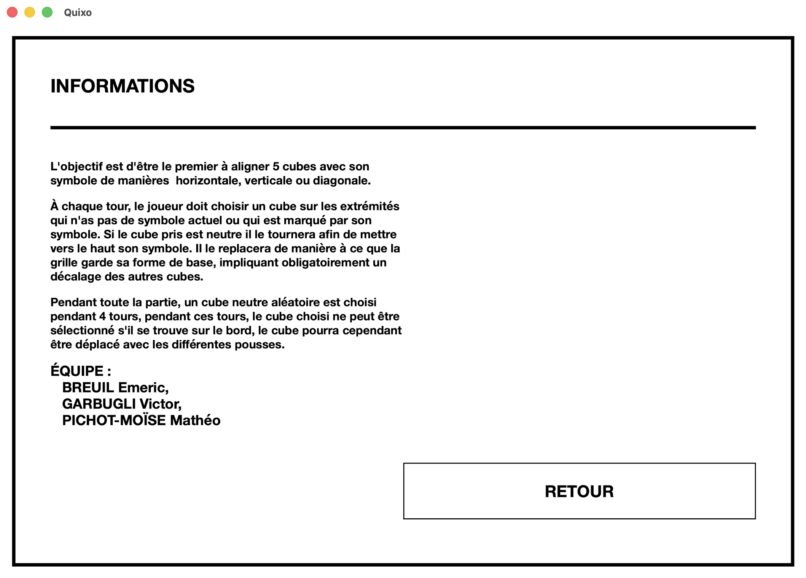

<div align="center">
    
    <h1>QUIXO.</h1>
</div>

<div align="center">
    
    
    
    
</div>

<br>

<div align="center">
    <a href="https://codefirst.iut.uca.fr/sonarqube/dashboard?id=CI_Quixo"></a>
    <br>
    <a href="https://codefirst.iut.uca.fr/gitlab/IUT_INF63/2026_1A_G12_MAUI/2026_1A_G1_BREUIL_GARBUGLI_PICHOTMOISE/-/wikis/home"></a>
    <br><br>
    <a href="https://opencast.dsi.uca.fr/paella/ui/watch.html?id=9a806f79-b38f-454e-a641-59aca904e839"></a>
</div>


## Table des matières

- [Avancement actuel](#avancement-actuel)
- [Prérequis](#prérequis)
- [Comment lancer QUIXO](#comment-lancer-quixo)
- [Comment lancer l'application console](#comment-lancer-lapplication-console)
- [Démo](#démo)
- [Structure du projet](#structure-du-projet)
- [Problèmes connus](#problèmes-connus)
- [Contributeurs](#contributeurs)

# Avancement actuel

Le projet est actuellement fonctionnel sur plusieurs axes:

- un moteur de jeu partagé dans `src/Quixo.Lib` avec les modèles, les managers et les règles de base du Quixo;
- une application console jouable dans `src/Quixo.Console` avec les modes joueur contre joueur, joueur contre bot, les scénarios stub et le chargement de partie;
- une persistance JSON dans `src/Quixo.Json` pour sauvegarder et recharger les parties;
- une suite de tests dans `src/Quixo.Tests` pour valider le comportement principal;
- une application MAUI toujours présente dans `src/Quixo.Maui` pour l’interface graphique.

Les sauvegardes sont écrites automatiquement dans un dossier `save/` à la racine du dépôt, au même niveau que `src/` et `docs/`.

# Prérequis

- [.NET SDK 10](https://dotnet.microsoft.com/download) installé
- Workload MAUI installé:

    ```bash
    dotnet workload install maui
    ```

- Git (pour cloner le dépôt)

# Comment lancer QUIXO


Pour exécuter le projet, il faut d’abord s’assurer que les dépendances .NET sont restaurées :

```bash
dotnet restore src/Quixo.Console.slnx
dotnet restore src/Quixo.Maui.slnx
```

## Version console

Pour compiler puis lancer la version console :

```bash
dotnet build src/Quixo.Console/Quixo.Console.csproj
dotnet run --project src/Quixo.Console/Quixo.Console.csproj
```

Au démarrage, le jeu propose plusieurs modes : joueur contre joueur, joueur contre bot, chargement d’un scénario stub ou reprise d’une partie sauvegardée.

## Version MAUI

Pour compiler puis lancer la version MAUI :

```bash
dotnet build src/Quixo.Maui.slnx
dotnet run --project src/Quixo.Maui/Quixo.Maui.csproj
```

L’environnement doit avoir le workload MAUI installé avant de lancer ces commandes.

## Sauvegardes

La partie sauvegardé se trouve dans le dossier `save/` et porte le nom de `partie_quixo.json`.

# Démo

<div align="center">
    <table>
        <tr>
            <td></td>
            <td></td>
        </tr>
        <tr>
            <td></td>
            <td></td>
        </tr>
    </table>
</div>

# Structure du projet

```md
2026_1A_G1_BREUIL_GARBUGLI_PICHOTMOISE/
├─ .gitignore
├─ .gitlab-ci.yml
├─ README.md
├─ save/
├─ docs/
│  ├─ README/
│  └─ Wiki/
└─ src/
    ├─ Quixo.Console/
    ├─ Quixo.Json/
    ├─ Quixo.Lib/
    ├─ Quixo.Maui/
    ├─ Quixo.Tests/
    └─ Quixo.stub/
```

# Problèmes connus

- Problème de détection fin du round car la list 2D est mal update ce qui la fausse et ne reflète pas le vrai plateau. Donc situation gagnante sur le plateau mais en réalité pas du tout.

# Contributeurs

- [BREUIL Emeric](mailto:Emeric.BREUIL@etu.uca.fr)
- [GARBUGLI Victor](mailto:Victor.GARBUGLI@etu.uca.fr)
- [PICHOT-MOISE Mathéo](mailto:Matheo.PICHOT-MOISE@etu.uca.fr)
